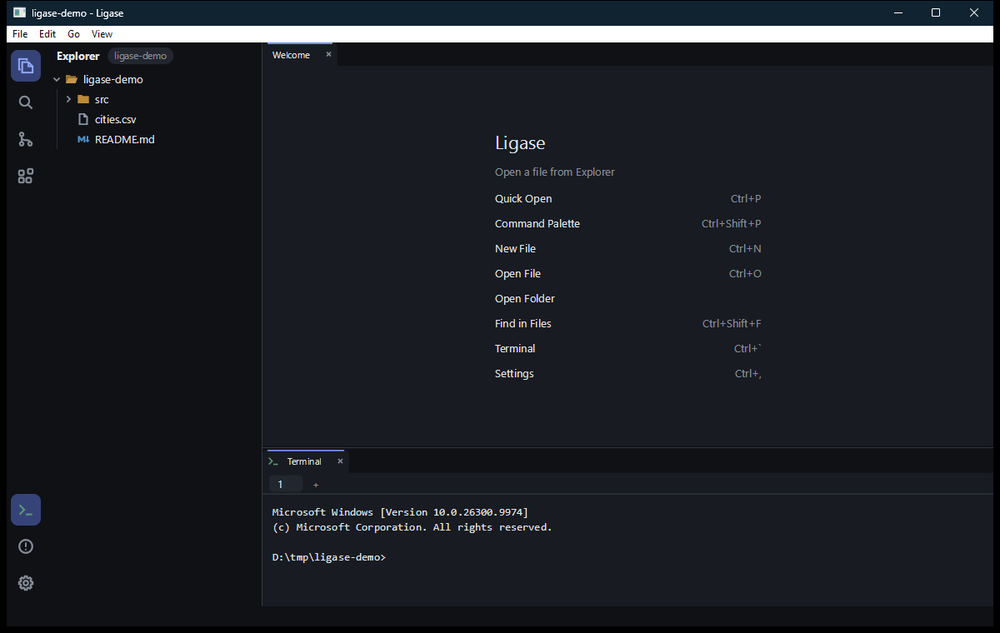
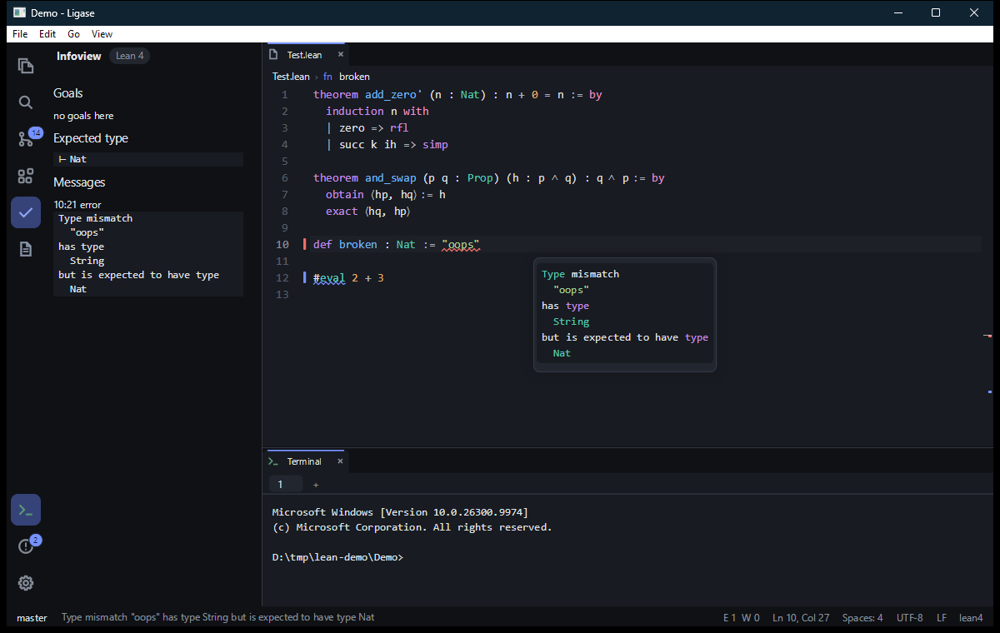
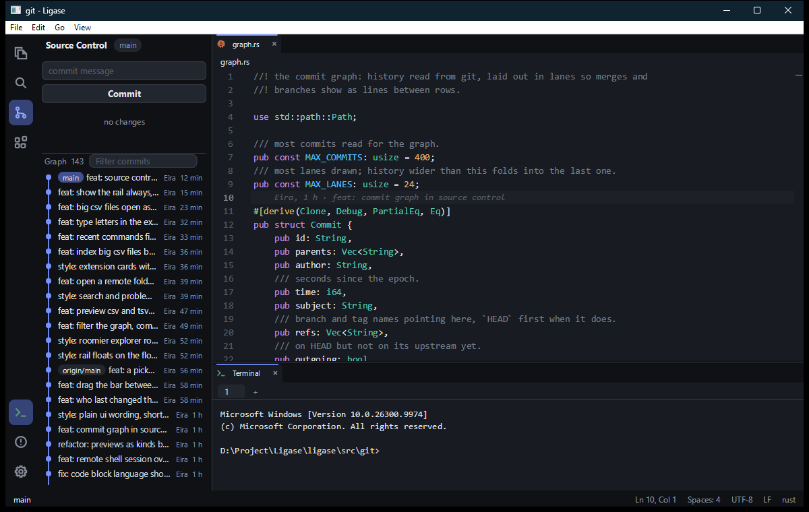
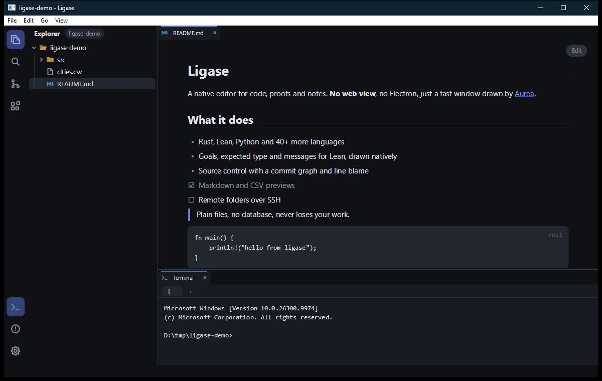
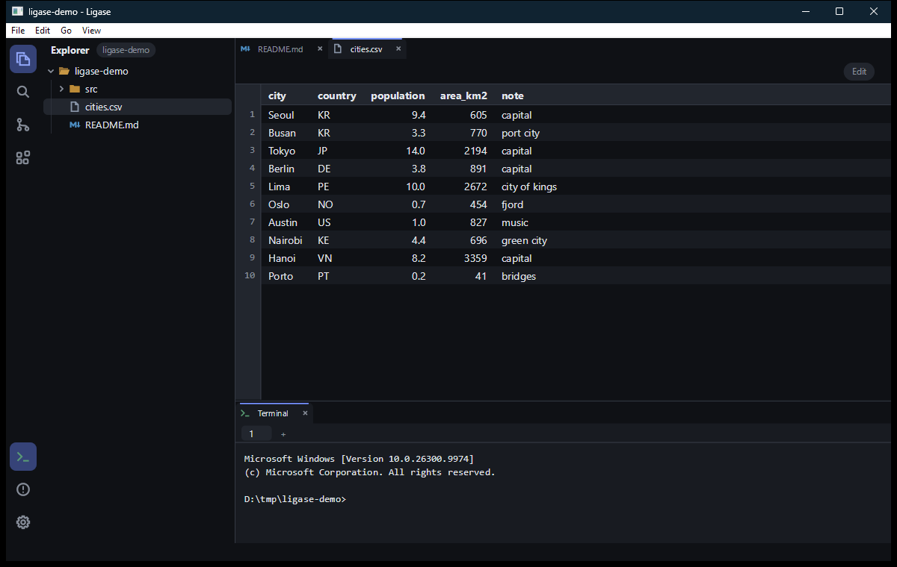

# ligase

a native text editor. no web view, no electron, no js runtime. one window drawn by [aurea](https://github.com/SkuldNorniern/aurea), a cpu renderer by default.



## what it does

- editing: multiple carets, box select, folding, word wrap, sticky scope lines, snippets with tab stops, abbreviations
- language servers: problems, hover, completion, signature help, go to definition, references, rename, format, quick fixes
- syntax colours from [sylven](https://github.com/SkuldNorniern/sylven), incremental, 40+ languages
- source control: staging, commits, a commit graph across every repository in the folder, blame at the end of the caret's line
- previews: markdown as a page, csv and tsv as a table, big csv files read straight from disk
- terminal with several shells, local or over ssh
- remote folders over ssh: browse, open, save back
- extensions as plain folders: languages, grammars, snippets, views, language servers (only the programs you allow)
- english and korean

## lean 4

the lean extension in `Docs` gives goals, expected type and messages in a native infoview, `\to` style input, quick fixes for `exact?`, and file progress in the gutter.



## source control

the graph shows lanes, merges, branch names and who changed what. a click on a commit shows its message and files. the dim note at the end of the line is who last changed it.



## previews

markdown reads as a page in the same tab, ctrl+shift+v or the read chip. csv files show as a table; files too big for the editor open the same way, one pass to find the rows, then only the rows in sight are read.





## install

builds are on the [releases](https://github.com/SkuldNorniern/ligase/releases) page, `nightly` follows main.

- windows: `ligase-*-setup.exe`, or the zip for a folder you keep yourself. the setup can add ligase to PATH and an "Open with Ligase" entry on folders
- macos: `ligase-*.dmg`, drag Ligase into Applications. it is not notarized yet, so open it once with right click, Open
- linux: `ligase-*.tar.gz` holds `bin/` and `share/`, unpack it into `~/.local` or `/usr/local`

## build

```
cargo build --release
```

`resolvase` and `vanta` sit next to this folder. `kago build` makes the windows setup in `dist/`.

windows 11 first; linux and macos are next. needs `git` on the path for source control and `ssh` for remote work.

## rules it keeps

- never loses work: saves are atomic, changes on disk never get silently written over
- the ui thread never waits on disk, processes or the network
- files, servers and extensions are untrusted input: size caps, no panics
- no database: settings, sessions and caches are plain files
